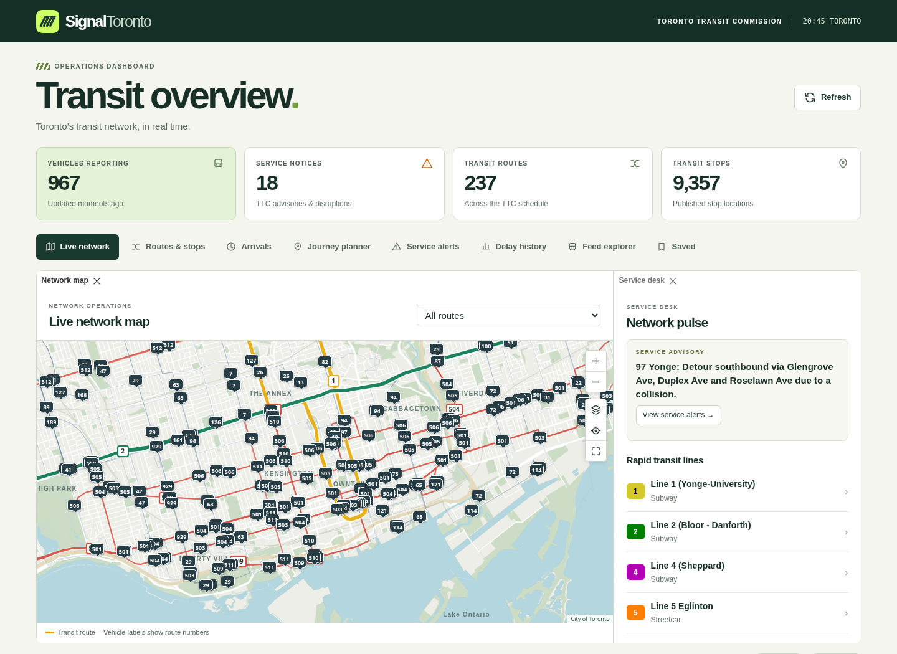
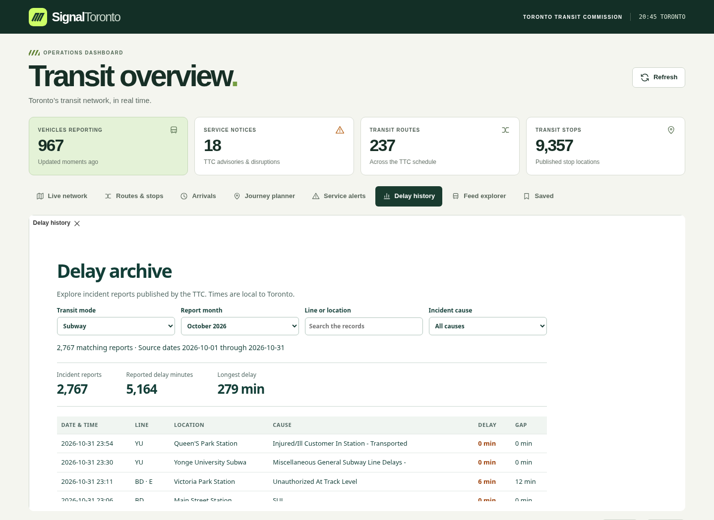
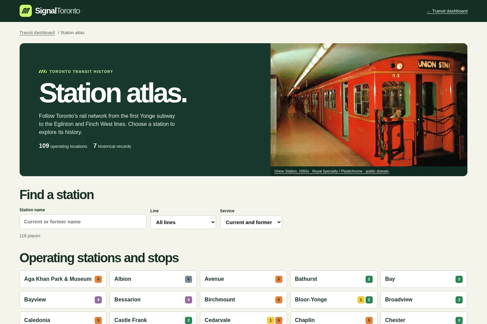

# Signal Toronto

A dockable Toronto public transit dashboard with a vehicle map, service alerts, a searchable route and stop directory, arrival predictions, service-day timetables, trip stop sequences, saved routes and stops, and historical delay analysis.

[Open the dashboard](https://ding-ding-projects.github.io/ttc-signal/) · [Rider guide](https://ding-ding-projects.github.io/ttc-signal/guide.html)

## Run locally

From the repository root, run `python3 -m http.server 8080 --directory public` and open http://localhost:8080. The site runs as static ES modules. Live surface observations need internet access. Scheduled service and delay records are served from the bundled dataset. The app labels the last reported update time. Real-time coverage varies by route and mode.

## Refresh the data

Run `python3 scripts/compile_schedule.py` for TTC static GTFS, and `python3 scripts/update_history.py` for monthly Toronto delay reports. Install `gtfs-realtime-bindings==1.0.0` and run `python3 scripts/refresh_realtime.py` to regenerate the timestamped GTFS Realtime snapshots. The Pages workflow refreshes the timetables and incident archive daily and the realtime snapshots twice an hour. Live surface vehicles and predictions load directly in the browser. See the rider guide for data provenance and credits.

The browser interface uses bundled Leaflet and dockview. Their licences are included with the distribution.

## Dashboard views

Use the journey planner for direct trips and same-stop connections. The feed explorer exposes reported occupancy, cancellations and stop-level trip updates. Travel times in the planner are scheduled. Vehicle predictions and historical incident minutes have separate views and timestamps.

## Portable edition

The Windows x64 executable in Releases opens the dashboard in your browser and serves the included map, timetable and rider guide from a loopback address. Keep its console window open while using it. The bundled timetable has the service dates of the release. Live predictions still require an internet connection. Saved items persist on the usual port, 38471. When that port is busy, the launcher chooses a temporary port with separate browser storage.

Build it from the repository root with `GOOS=windows GOARCH=amd64 go build -trimpath -o SignalToronto.exe portable.go`. A native build with `go build -o signal-toronto portable.go` uses the same embedded files.

## Station atlas

[Browse current and former stations](https://ding-ding-projects.github.io/ttc-signal/stations/). Every location has a static page with cited history. Operating stations include links to adjacent stations and platform departures. The catalogue follows the five operating rapid-transit lines, including surface light-rail stops; interchanges share one history. Former station and platform records are labeled separately.

Historical research and image credits are stored in `scripts/station-data/`. After updating the records or the schedule, run `python3 scripts/build_station_atlas.py`. The builder reconciles the records with complete scheduled trips and reports missing stations or transfer lines. Generate the phone-size PDF with `python3 scripts/build_station_pdf.py` (requires ReportLab).

The [Bloor-Yonge mobile view](docs/bloor-yonge-mobile.webp) shows the shared interchange history. Both images were captured from the published atlas.
